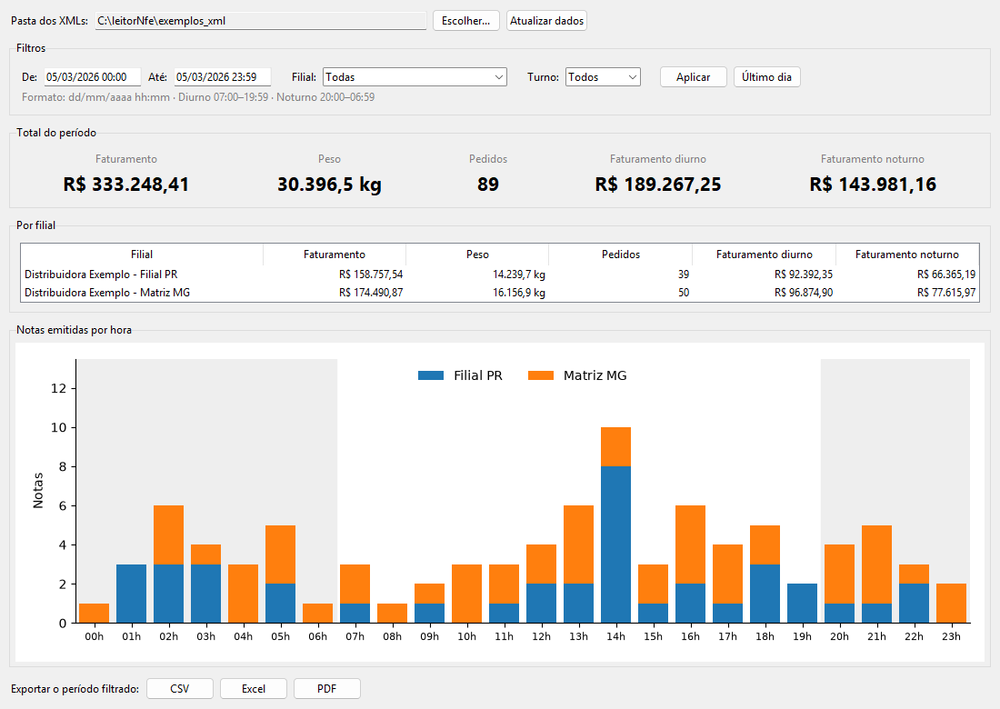
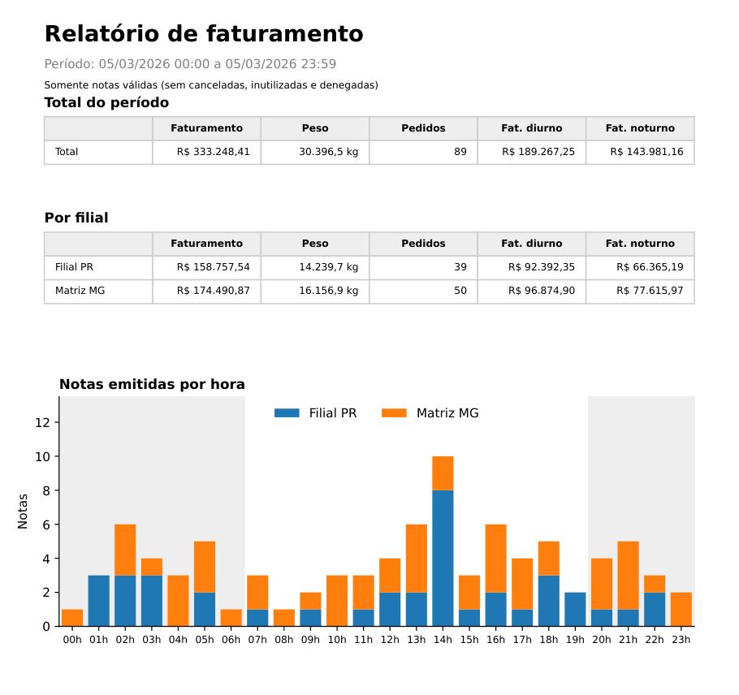

# Relatório de faturamento a partir de XMLs de NF-e

Programa desktop que lê uma pasta de notas fiscais eletrônicas (XML), guarda os dados num banco
SQLite e mostra o faturamento de um período: total, por filial, por turno e por hora.



Relatório exportado em PDF ([arquivo de exemplo](docs/exemplo_relatorio.pdf)):



> **Os dados deste repositório são fictícios.** A pasta [`exemplos_xml`](exemplos_xml/LEIA-ME.md)
> tem 436 XMLs de uma distribuidora de alimentos inventada (matriz em MG e filial no PR). Nenhum
> dado real de empresa ou cliente foi usado.

## O problema

Empresas que emitem muitas notas fiscais por dia precisam saber quanto faturaram de verdade.
Somar os valores dos XMLs parece simples, mas há armadilhas:

- notas **canceladas** ou com número **inutilizado** não podem entrar na conta;
- a mesma nota pode aparecer **duas vezes** em pastas diferentes;
- o **peso** de cada item pode vir em kg, em caixas (com o peso real em outro campo) ou só no
  volume de transporte;
- o turno noturno começa às 20h e **passa da meia-noite**, então "um dia" de faturamento não é
  igual ao dia do calendário.

## O que o programa mostra

- **Total do período:** faturamento (R$), peso (kg), pedidos e faturamento diurno e noturno.
- **Por filial:** os mesmos números, separados por filial.
- **Notas emitidas por hora:** gráfico das 24 horas com uma cor por filial. O fundo cinza marca
  o turno noturno.
- **Filtros:** período com data e hora (pode atravessar a meia-noite, ex.: 22:00 de um dia até
  07:00 do outro), filial e turno.
- **Exportação** do período filtrado: notas em CSV ou Excel e o relatório em PDF de uma página ([exemplo](docs/exemplo_relatorio.pdf)).

## Como usar

```bash
pip install -r requirements.txt
python app.py
```

Na tela, clique em **Escolher...**, selecione a pasta `exemplos_xml` e depois **Atualizar dados**.

## Como o código está organizado

| Arquivo | O que faz |
|---|---|
| `leitor.py` | Lê um XML e devolve os dados da nota, do cancelamento ou da inutilização |
| `banco.py` | Grava no SQLite. Na segunda vez só lê os arquivos novos ou alterados |
| `relatorio.py` | Regras de negócio e cálculos com pandas (status, turno, totais, exportação) |
| `app.py` | Tela em Tkinter, com gráfico do matplotlib |
| `graficos.py` | Formatação de valores e o gráfico por hora (usados na tela e no PDF) |
| `pdf.py` | Relatório em PDF, feito com o próprio matplotlib |
| `exemplos_xml/` | XMLs fictícios para testar e demonstrar |
| `tests/` | Testes com pytest. `gabarito.json` tem o resultado esperado de cada nota de exemplo |

Ferramentas: Python, pandas, matplotlib, SQLite (`sqlite3`) e Tkinter. As duas últimas já
vêm com o Python.

## Regras de negócio

| Situação | Regra |
|---|---|
| Nota autorizada | sem protocolo, ou protocolo 100/150. Outro código = denegada (não conta) |
| Cancelamento | vale se o arquivo não tem retorno da SEFAZ ou se o retorno é 135/155 |
| Inutilização | vale sem retorno ou com retorno 102. A faixa é comparada pelo CNPJ, série, ano e número da nota |
| Nota repetida | conta uma vez só (mesma chave de acesso) |
| Peso do item | unidade de venda em kg → quantidade; senão unidade tributável em kg → quantidade tributável; senão `pesoB`/`pesoL` do item |
| Peso da nota | soma dos itens; se nenhum item tem peso, usa o volume de transporte |
| Turno | diurno das 07:00 às 19:59, noturno das 20:00 às 06:59 |
| Pedidos | quantidade de notas válidas |

## Testes

```bash
pip install -r requirements-dev.txt
pytest
```

Os testes leem os `exemplos_xml` e conferem, nota a nota, se o status e o peso calculados batem
com o `tests/gabarito.json`. Também verificam o peso de cada tipo de item, se o total é a soma
das filiais, o filtro atravessando a meia-noite, arquivos quebrados e a exportação para Excel.

## Licença

MIT
